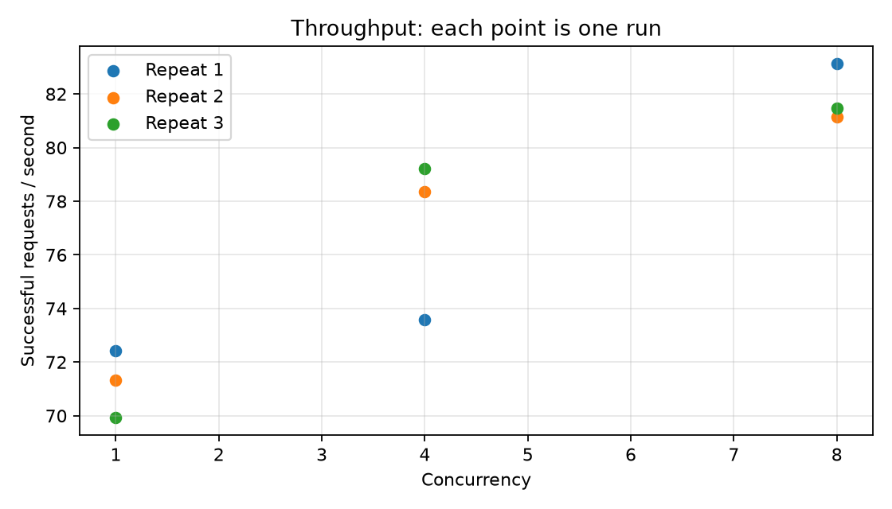
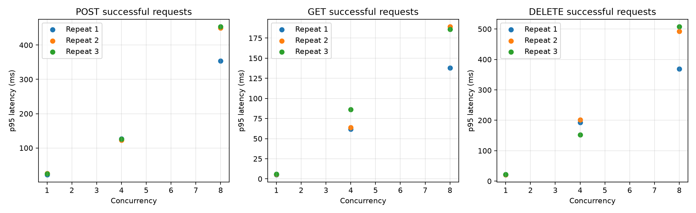
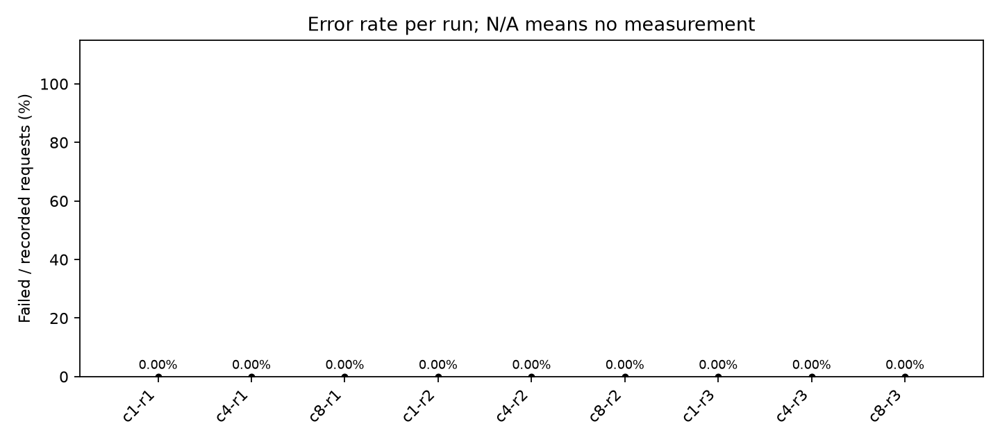

# Phân tích kiểm thử tải trên Kaggle

Batch: `20261027T154217Z-a5e499c1` — ngày 27/10/2026 (UTC).

## 1. Kết quả chính

Smoke và **9/9 lần baseline hoàn tất**, không ghi nhận request task thất bại. Baseline hoàn thành **3.900 chu trình / 11.700 request** POST → GET → DELETE. Throughput tăng ít khi tăng tải, trong khi độ trễ p95 tăng rõ rệt. Đây là bằng chứng workload đã chạy thành công ở các mức tải đã thử; chưa đủ để kết luận năng lực tối đa hoặc đáp ứng SLA.

**Cấu hình thực tế là 100 vòng/user và 3 lần/mức**, không phải 25 vòng/user và 1 lần/mức như ví dụ hướng dẫn ban đầu.

### Bảng kết quả đo lường tổng quan

| Mức tải (Concurrency) | Số vòng (Iterations) | Throughput (req/s) | p50 Latency (ms) | p95 Latency (ms) | Tỷ lệ lỗi (Error %) |
|---:|---:|---:|---:|---:|---:|
| 1 | 100 | 71.23 | 15.03 | 22.43 | 0.00% |
| 4 | 100 | 77.05 | 28.20 | 136.66 | 0.00% |
| 8 | 100 | 81.92 | 35.95 | 350.79 | 0.00% |

Cách tổng hợp:

- **Iterations = 100** là số chu trình/user trong mỗi lần đo; mỗi mức tải được lặp 3 lần.
- **Throughput** là trung bình số học throughput thành công của 3 lần chạy, thống nhất với bảng tổng hợp ở mục 5.
- **p50/p95** được tính trên latency gốc của tất cả request thành công POST, GET và DELETE, gộp 3 lần chạy ở cùng mức tải (lần lượt 900 / 3.600 / 7.200 mẫu). Dùng chỉ số `round((n−1) × percentile / 100)` sau khi sắp xếp mẫu; không lấy trung bình các percentile. Đây là latency của một request, không phải của toàn chu trình.
- **Tỷ lệ lỗi** = tổng request thất bại / tổng request đã thực hiện × 100%.
- Chỉ dùng baseline chính thức; loại smoke, warm-up, đăng ký/login và health check.

## 2. Môi trường và nguồn bằng chứng

- Python **3.13.15**, không phải Python 3.12.
- Commit `be8a8781d56f10d80a931bd053d48ef8d4508408`; repository được đo báo `git_dirty=false`.
- Linux x86_64, CPU Intel Xeon 2,20 GHz; hệ thống báo 4 CPU, affinity 4; RAM tổng khoảng 31,35 GiB. Những giá trị này không chứng minh quota tài nguyên thực tế.
- Một worker Uvicorn; server và client cùng máy.
- SQLite mới mỗi lần chạy (`fresh_database_per_run`); setup tài khoản và warm-up lại cho từng lần.
- Concurrency 1/4/8; 100 vòng/user; 3 lần/mức; warm-up 5 vòng/user.
- HTTP timeout 30 giây; chờ startup tối đa 30 giây; giới hạn mỗi subprocess benchmark 1.800 giây.
- FastAPI 0.115.12, Uvicorn 0.34.2, SQLAlchemy 2.0.40, PyJWT 2.10.1; Matplotlib 3.11.2.

Nguồn: [environment.json](20261027T154217Z-a5e499c1/environment.json), [dependencies.txt](20261027T154217Z-a5e499c1/dependencies.txt), [plan.json](20261027T154217Z-a5e499c1/plan.json), [runs.csv](20261027T154217Z-a5e499c1/runs.csv), các JSON request gốc và log trong [thư mục kết quả](20261027T154217Z-a5e499c1/).

`git_dirty=false` mô tả repository API/benchmark đã clone; không chứng minh notebook đang chạy không được sửa trên Kaggle. Cần giữ notebook đã thực thi để tái lập các sửa đổi setup.

## 3. Kiểm tra tính đầy đủ

Đã đối chiếu 10 báo cáo (9 baseline + smoke), metadata điều phối, số bản ghi request và status kỳ vọng POST 201 / GET 200 / DELETE 204. Tất cả báo cáo hoàn tất, benchmark exit code 0; bộ đếm request khớp dữ liệu gốc, chu trình hoàn thành khớp dự kiến. Không có skipped/unrecorded request, incomplete cycle hoặc run_errors; commit và cấu hình trong CSV/JSON phù hợp batch.

| Phần | Chu trình hoàn thành | Request task thành công | Request lỗi |
|---|---:|---:|---:|
| Baseline chính thức | 3.900 | 11.700 | 0 |
| Warm-up của baseline | 195 | 585 | 0 |
| Smoke chính thức | 25 | 75 | 0 |
| Warm-up của smoke | 5 | 15 | 0 |
| Tổng task request đã ghi | 4.125 | 12.375 | 0 |

Đăng ký/login và health check không nằm trong các số request task trên. Thời gian đo và throughput chính thức không gộp setup hoặc warm-up. Smoke có thời gian đo 1,094 giây, được loại khỏi thống kê baseline.

## 4. Kết quả từng lần baseline

Throughput là request **thành công**/giây; latency p95 tính trên request thành công của từng method. Tất cả các lần có error rate 0%.

| Lần | Concurrency | Vòng hoàn tất | Request | Thời gian đo (s) | Throughput (req/s) | POST p95 (ms) | GET p95 (ms) | DELETE p95 (ms) |
|---|---:|---:|---:|---:|---:|---:|---:|---:|
| c1-r1 | 1 | 100 | 300 | 4.142 | 72.43 | 22.08 | 5.19 | 21.16 |
| c4-r1 | 4 | 400 | 1200 | 16.308 | 73.58 | 127.13 | 61.64 | 193.10 |
| c8-r1 | 8 | 800 | 2400 | 28.874 | 83.12 | 354.31 | 137.91 | 368.96 |
| c1-r2 | 1 | 100 | 300 | 4.205 | 71.34 | 25.89 | 5.63 | 21.29 |
| c4-r2 | 4 | 400 | 1200 | 15.316 | 78.35 | 122.83 | 63.92 | 202.07 |
| c8-r2 | 8 | 800 | 2400 | 29.576 | 81.15 | 449.50 | 189.11 | 492.66 |
| c1-r3 | 1 | 100 | 300 | 4.290 | 69.94 | 25.23 | 5.82 | 22.46 |
| c4-r3 | 4 | 400 | 1200 | 15.148 | 79.22 | 126.23 | 86.16 | 152.14 |
| c8-r3 | 8 | 800 | 2400 | 29.454 | 81.48 | 453.43 | 186.10 | 507.46 |

## 5. Tổng hợp theo mức tải

Throughput trung bình là trung bình số học của ba lần chạy; SD là độ lệch chuẩn mẫu (n−1), không phải khoảng tin cậy.

| Concurrency | Throughput TB ± SD (req/s) | Min–max (req/s) | CV (%) |
|---|---:|---:|---:|
| 1 | 71.23 ± 1.25 | 69.94–72.43 | 1.75 |
| 4 | 77.05 ± 3.03 | 73.58–79.22 | 3.94 |
| 8 | 81.92 ± 1.06 | 81.15–83.12 | 1.29 |

Bảng latency sau **tính lại từ dữ liệu request gốc của cả ba lần**, không lấy trung bình p95. Dùng cùng quy tắc percentile của benchmark: sắp xếp mẫu và lấy chỉ số `round((n−1) × percentile / 100)`. Các mẫu chỉ thuộc phần đo chính thức.

| Concurrency | Mẫu mỗi method | POST p50 / p95 (ms) | GET p50 / p95 (ms) | DELETE p50 / p95 (ms) |
|---|---:|---:|---:|---:|
| 1 | 300 | 19.80 / 24.89 | 4.65 / 5.63 | 18.53 / 22.11 |
| 4 | 1200 | 29.53 / 125.56 | 7.14 / 85.50 | 41.46 / 193.10 |
| 8 | 2400 | 38.51 / 448.38 | 16.88 / 186.10 | 54.62 / 458.62 |

## 6. Diễn giải

- Từ concurrency 1 lên 4, throughput trung bình tăng **8.2%**. Từ 4 lên 8 chỉ tăng **6.3%**. Từ 1 lên 8 tổng cộng tăng **15.0%**, dù số user đồng thời tăng 8 lần.
- POST p95 mỗi lần tăng từ 22,08–25,89 ms (c1) lên 354,31–453,43 ms (c8). DELETE tăng từ 21,16–22,46 ms lên 368,96–507,46 ms. GET tăng từ 5,19–5,82 ms lên 137,91–189,11 ms.
- Ở c8, throughput khá ít dao động (81,15–83,12 req/s), nhưng DELETE p95 dao động 368,96–507,46 ms. Throughput ổn định không đồng nghĩa độ trễ đuôi ổn định.
- Quan sát phù hợp với hiện tượng chờ đợi/cạnh tranh tài nguyên khi tăng đồng thời. SQLite ghi dữ liệu, một worker server, chi phí client và I/O đều là các giả thuyết cần đo thêm; **chưa có bằng chứng xác định SQLite là nút thắt**.

## 7. Biểu đồ của batch

Các điểm trên biểu đồ hiệu năng là từng lần chạy riêng, không phải p95 gộp ở mục 5.

